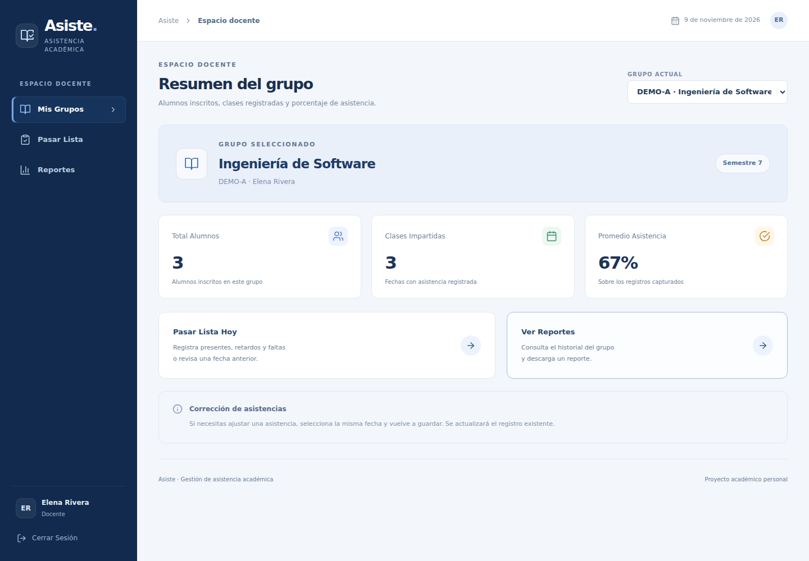
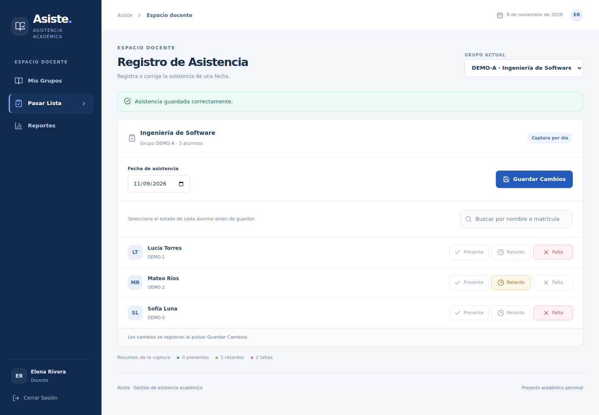
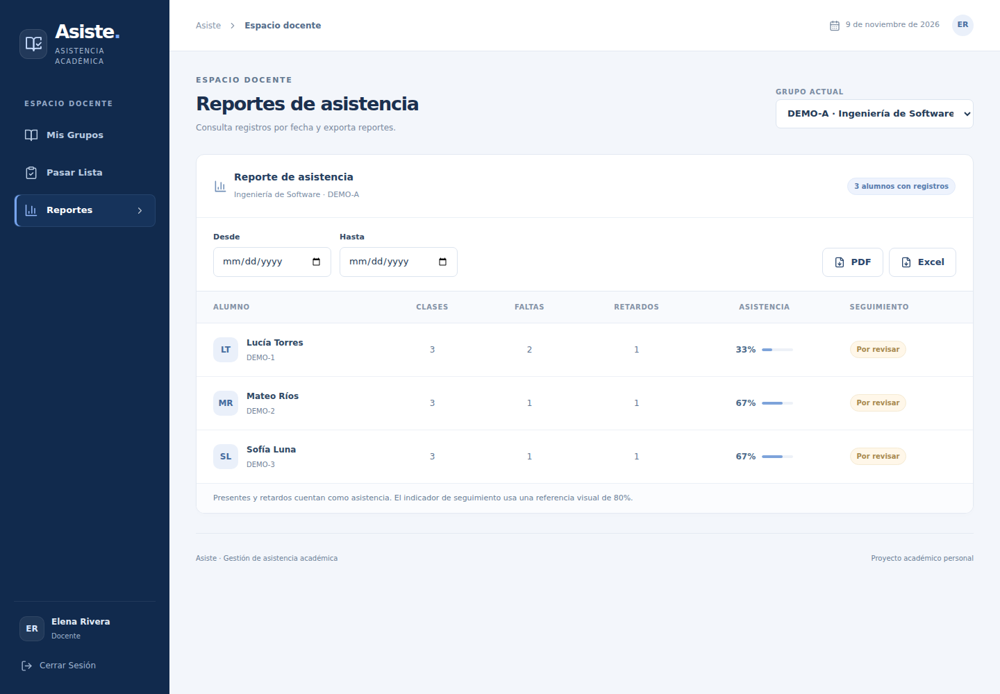
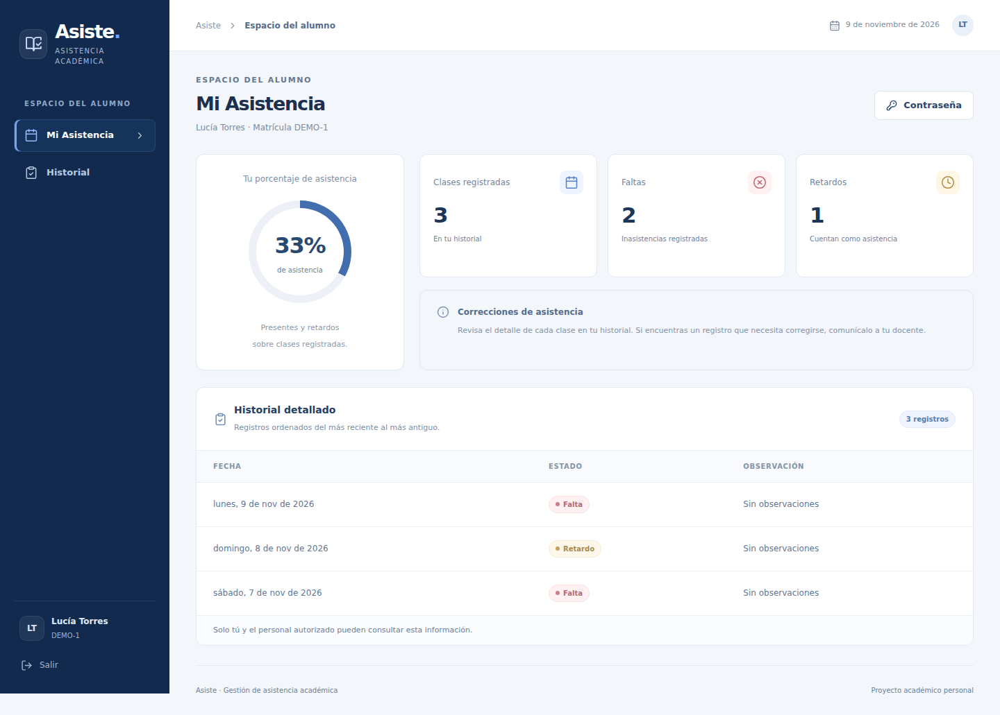
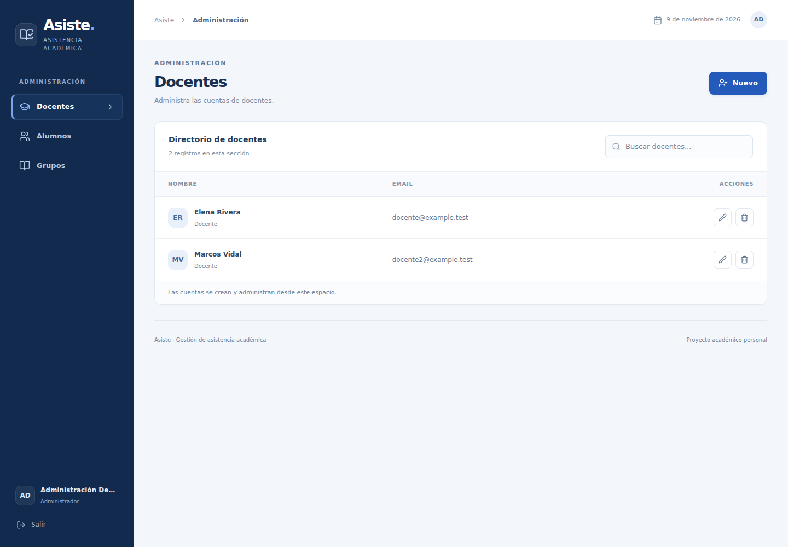
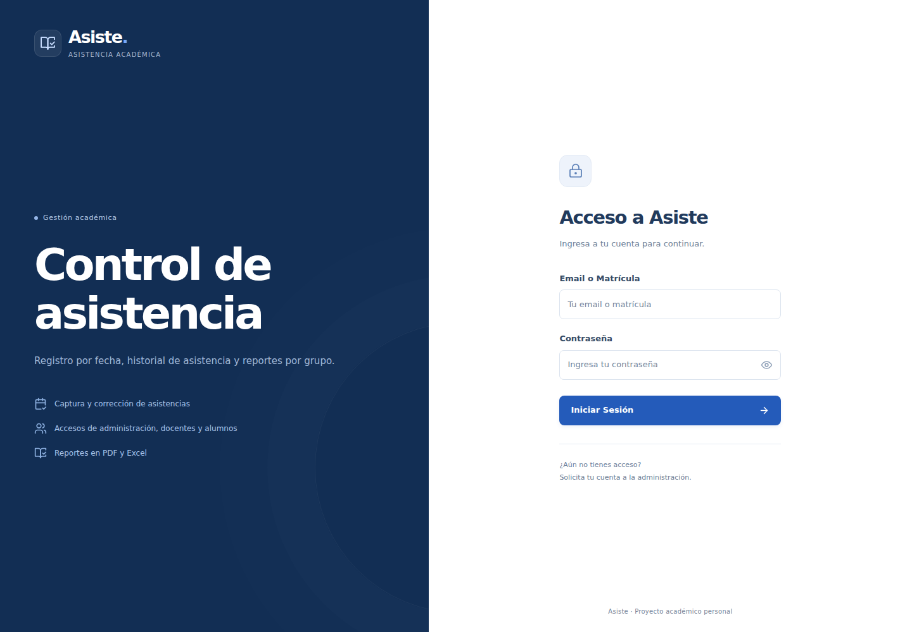
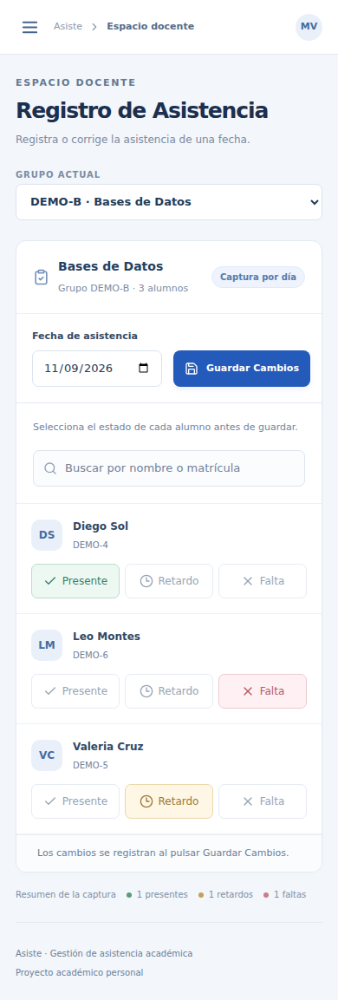

# Asiste

Gestión de asistencia académica con cuentas de administración, docentes y alumnos. Permite registrar clases, corregir asistencias y consultar reportes sin exponer información de otros grupos.


Proyecto académico personal de **David Ignacio Becerra Morán**, estudiante de Ingeniería de Software de la Universidad Autónoma de Zacatecas. Incluye permisos por recurso, una demo aislada y pruebas reproducibles. Las cuentas, nombres y asistencias de la demo son ficticios; no representa un sistema institucional en operación.

## Vista principal



## Demostración

| Administración | Docente | Alumno |
| --- | --- | --- |
| Alta y edición de docentes, alumnos y grupos. Eliminación controlada cuando no existen referencias o historial. | Consulta de grupos propios, captura/corrección por fecha, estadísticas y reportes PDF/XLSX. | Consulta del resumen e historial propios y cambio de contraseña. |

<details>
<summary>Ver captura de asistencia, reportes y paneles por rol</summary>

**Captura:** cambiar un estado y guardar actualiza el registro de ese alumno, grupo y fecha.



**Reportes:** incluyen presentes y retardos como asistencias. El porcentaje usa los registros capturados, no un calendario oficial de clases.



**Alumno:** el backend devuelve únicamente su propia información, incluso si intenta modificar la URL o los parámetros.



**Administración:** las cuentas se crean desde este panel; el registro público está deshabilitado.



</details>

<details>
<summary>Ver el acceso y la versión móvil</summary>





</details>

## Interfaz

Los textos describen funciones, estados e instrucciones. Se evitan lemas promocionales en las pantallas.

Los tres roles comparten navegación azul marino, fondo claro y una jerarquía visual consistente. Los directorios y la lista de asistencia permiten buscar registros sin salir de la vista. Los controles de asistencia muestran texto y estado seleccionado, además del color.

En móvil, el menú se abre desde la cabecera. Los formularios admiten navegación por teclado y cierre con Escape; al cerrarse, devuelven el foco al control que los abrió. El login permite mostrar u ocultar la contraseña. No se añadieron dependencias para el rediseño.

## Probar en pocos pasos

Requisitos: **Node.js 22.12 o posterior dentro de la rama 22** (probado con 22.22.1), npm e internet para descargar dependencias. Ejecuta los comandos desde la raíz del proyecto.

```bash
npm ci
npm run build
npm run demo
```

Abre **http://127.0.0.1:3000**. No necesitas configurar `.env` ni instalar MongoDB para esta modalidad.

`npm run demo` ejecuta un proceso MongoDB **8.0.16** aislado, en una base temporal llamada `asiste_demo`. Genera un secreto JWT aleatorio para esa ejecución y solo escucha en la interfaz local. La primera vez descarga el binario MongoDB a la caché del usuario; no instala un servicio. Al detenerlo con `Ctrl+C`, se eliminan únicamente los datos de esa instancia temporal. La siguiente ejecución empieza una demo nueva.

Si el puerto está ocupado, usa `DEMO_PORT=3001 npm run demo`.

### Cuentas ficticias

Contraseña inicial para todas las cuentas: **`DemoAsiste2026!`**.

| Rol | Email o matrícula | Alcance |
| --- | --- | --- |
| Administración | `admin@example.test` | Administración de la demo |
| Docente | `docente@example.test` | Grupo DEMO-A |
| Otro docente | `docente2@example.test` | Grupo DEMO-B |
| Alumno | `DEMO-1` | Historial de Lucía Torres, DEMO-A |
| Otros alumnos | `DEMO-2` a `DEMO-6` | Historial individual; DEMO-4 a DEMO-6 pertenecen a DEMO-B |

Se incluyen dos grupos, dos docentes y seis alumnos, con registros de tres días relativos a la creación de la demo, tomando la fecha de Ciudad de México. Administración es una cuenta adicional. Cambiar una contraseña en la demo temporal afecta esa ejecución; reiniciarla crea datos nuevos.

## MongoDB persistente y desarrollo

Para conservar datos entre ejecuciones, utiliza MongoDB local o una instancia administrada. Opcionalmente, si ya tienes Docker Compose disponible:

```bash
docker compose up -d mongo
cp .env.example .env
node -e "console.log(require('crypto').randomBytes(48).toString('hex'))"
```

Copia el valor generado a `JWT_SECRET` dentro de `.env`:

```dotenv
MONGO_URI=mongodb://127.0.0.1:27017/asiste_demo
JWT_SECRET=tu_valor_aleatorio_de_al_menos_32_caracteres
PORT=3000
```

Después:

```bash
npm run seed:demo
npm run build
npm start
```

El seeder **solo acepta la base `asiste_demo`**, comprueba colisiones con los identificadores reservados y agrega los registros faltantes. No ejecuta borrados, no reemplaza registros ni reinicia contraseñas o asistencias editadas. Para una demo completamente nueva, usa la modalidad temporal.

Las entradas antiguas `node seed_admin.js` y `node backend/seeder.js` delegan al mismo proceso protegido. No se deben usar para restablecer contraseñas.

Para desarrollo, con `.env` y MongoDB persistente preparados, abre dos terminales:

```bash
npm run dev:server
```

```bash
npm run dev
```

Abre la URL que muestra Vite (normalmente `http://127.0.0.1:5173`). El proxy `/api` usa el `PORT` configurado. `npm run preview` muestra el build, pero no sustituye al backend; para demostrar la aplicación completa utiliza `npm start` o `npm run demo`.

## Comandos y verificación

| Comando | Propósito |
| --- | --- |
| `npm test` | Pruebas de configuración y API contra MongoDB aislado; no utiliza `MONGO_URI` ni toca tu BD |
| `npm run build` | Build de producción de React |
| `npm run check` | Pruebas de API y build |
| `npm run test:e2e` | Flujos reales en Chromium con backend y MongoDB temporales |
| `CAPTURE_DOCS=1 npm run test:e2e` | Repite los flujos y actualiza las capturas reales del README |
| `npm run seed:demo` | Agrega datos ficticios a la base persistente `asiste_demo` |
| `npm run demo` | Inicia la demo temporal desde el build existente |

Para ejecutar las pruebas de navegador, prepara el navegador de Playwright una vez y construye la interfaz:

```bash
npx playwright install chromium
npm run build
npm run test:e2e
```

En Linux, Chromium necesita bibliotecas del sistema. Si faltan, Playwright informa cuáles; su instalación corresponde a la configuración del equipo. Este proyecto no instala paquetes del sistema automáticamente. Puedes usar un Chromium existente mediante `PLAYWRIGHT_CHROMIUM_EXECUTABLE_PATH=/ruta/a/chrome`.

Se incluye un workflow de GitHub Actions para ejecutar estas comprobaciones después de publicar; todavía no se ha ejecutado en GitHub.

Las pruebas cubren login correcto/incorrecto, tokens inválidos, roles actualizados, registro público bloqueado, operaciones administrativas, acceso entre grupos, datos individuales, contraseñas y captura/corrección de asistencia. En navegador se comprueban también recarga, estados vacíos, navegación móvil y archivos exportados. Consulta [el registro de verificación](docs/VERIFICACION.md) para conocer la evidencia y los límites de la última ejecución.

## Organización

```text
backend/
  app.js                Aplicación Express sin abrir puertos al importarla
  config/               Variables de entorno y conexión MongoDB
  middleware/           Autenticación, roles y acceso a grupos
  controllers/          Reglas y operaciones de cada recurso
  models/               Esquemas, índices y hash de contraseñas
  routes/               Endpoints y composición de permisos
  utils/                Validaciones y manejo asíncrono
frontend/src/
  auth/                 Contexto de sesión
  api/                  Acceso HTTP y adaptación de reportes
  components/           Navegación común, diálogos, login, filas y tarjetas
  dashboards/           Paneles de administración, docente y alumno
scripts/                Datos ficticios y arranque de demo
tests/                 Pruebas de API, configuración y navegador
server.js               Inicio validado, conexión y cierre del servidor
```

## Decisiones técnicas

1. **Rol y pertenencia al recurso son verificaciones distintas.** El middleware autentica el JWT y consulta la cuenta actual. Después exige el rol adecuado y comprueba que el grupo pertenece al docente. Un alumno solo recibe su fila de reporte y su historial. Ocultar controles en React no otorga ni elimina permisos.
2. **Una asistencia por alumno, grupo y día.** Un índice único compuesto respalda los `upsert` usados para corregir capturas. El backend valida el lote y la pertenencia de todos los alumnos antes de enviarlo a MongoDB. Las fechas de asistencia se almacenan como días en UTC para evitar desplazamientos al consultar.
3. **Demo y pruebas con límites explícitos.** El mismo código Express se puede iniciar desde el servidor, las pruebas de API o la demo. Los fixtures usan `create()` para ejecutar el hook de bcrypt y conservan los datos ya existentes. Las pruebas ejecutan un `mongod` real; no simulan las consultas con mocks.

Se mantiene JavaScript, React y Express para conservar el alcance académico. La separación de paneles sigue los roles existentes, sin agregar un framework de rutas. PDF y Excel se generan localmente en el navegador y sus bibliotecas se cargan al solicitar la exportación. SheetJS 0.20.3 procede de su distribución oficial; la URL y su integridad quedan registradas en el lockfile.

## Limitaciones y próximos pasos

- Diseñado para demostración académica. Faltan recuperación de cuentas, invitaciones, limitación de intentos de login y auditoría para una operación pública.
- Los JWT duran dos horas y se guardan en `sessionStorage`. Cerrar sesión elimina la copia del navegador; no hay revocación individual del token en servidor.
- Un alumno tiene un grupo. El cambio de grupo con historial y los borrados que dejarían referencias se rechazan; una migración o archivado es una mejora futura.
- El lote se valida antes de escribir, pero no se promete una transacción multidocumento ante fallos de infraestructura. Tampoco se ha medido rendimiento ni carga concurrente.
- Los porcentajes se calculan sobre capturas existentes; los retardos cuentan como asistencia. No hay calendario escolar, ponderaciones configurables ni justificantes.
- La validación de navegador se centra en Chromium; otros navegadores y dispositivos físicos requieren pruebas adicionales.

## Autoría y licencia

Este proyecto se distribuye bajo la licencia [ISC](LICENSE), conservando la licencia indicada en el `package.json` académico original. Copyright (c) 2026 David Ignacio Becerra Morán. Las dependencias mantienen sus propias licencias.
